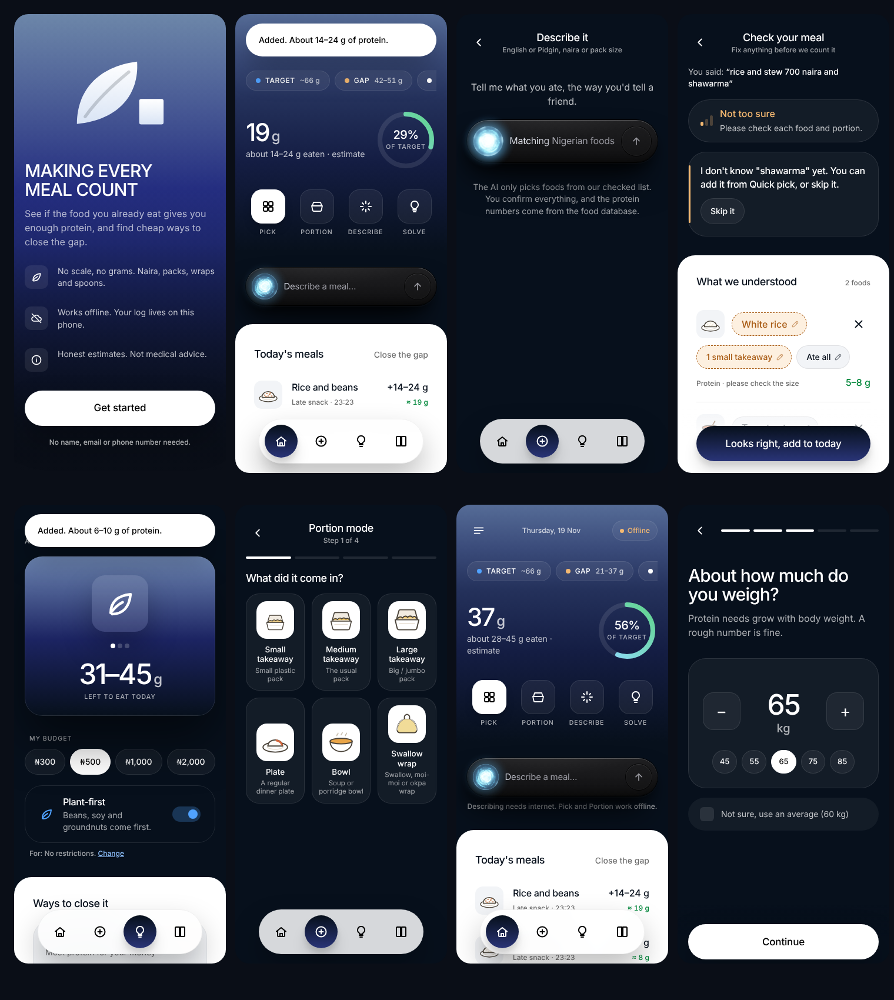

# Pronexa: making every meal count

An offline-first protein-gap app for Nigerian university students. Describe meals in naira, packs, wraps and spoons (never grams), see an honest estimate of your protein gap, and get affordable ways to close it, with beans, moi-moi, akara, soya, tofu (awara), groundnuts, okpa and lentils at the centre.

It ships as an **Android APK** (Capacitor) and as an installable **PWA** from the same code.

> Nutrition awareness tool, not medical advice. Every number is an estimate.

## Get the app




- **Android:** [`release/Pronexa-0.1.0-debug.apk`](release/Pronexa-0.1.0-debug.apk) (5.2 MB, Android 7.0+, debug-signed). On the phone, allow "Install unknown apps" for your browser or file manager, then open the file.
- **Web / PWA:** `npm install && npm run build && npm run preview`, then open it on a phone and use "Add to home screen".

## The five-step flow

1. **Onboarding:** diet (no restrictions, vegetarian, vegan, pescatarian, dairy-free, egg-free), allergies asked separately, then weight and activity. This gives a daily target shown as a range.
2. **Log a meal:** Quick pick (Nigerian food list), Portion mode (pack, plate, bowl or wrap pictures, then all, ¾, ½ or ¼ eaten), or **Describe it** in the Assistant Pill, in English or Pidgin, e.g. `₦1,000 rice and beans, medium takeaway`.
3. **Confirm:** editable chips for food, portion and amount eaten; a confidence level; one simple question when unsure. Nothing is counted until you confirm.
4. **Today (Protein Gap):** target, eaten and gap as ranges, with a progress ring and a small celebration when the gap closes.
5. **Gap Solver:** combos that close the gap within your budget, upgrades to the meals you already ate, and foods ranked by protein per ₦100. Each shows the protein change, the cost and a one-line reason. Plant-first toggle. Vegans are never shown animal products.

Later features (Photo mode, ₦500 Protein Challenge, Plant-based Meal Planner, Campus Protein Map, lessons) are "coming soon" screens.

## How it works

| Layer | Where | Notes |
|-------|-------|-------|
| Food database | `src/data/foods.ts` | 36 Nigerian foods, protein per 100 g with sources, portion presets in grams, date-stamped campus prices (Oct 2026) |
| Calculation engine | `src/lib/calc.ts` | `protein = per100g × grams × qty × eaten`, with an uncertainty band per portion type. No AI touches the numbers |
| AI interpreter | `src/ai/` | Any interpreter only *picks* food ids from the database. `validate.ts` drops unknown foods, fixes portions, uses price only as a clue, and decides confidence and the one question |
| Gap Solver | `src/lib/solver.ts` | Deterministic ranking (value per ₦, gap fit, plant bonus) with strict diet and allergen filtering. Works offline |
| Offline storage | `src/lib/db.ts`, `src/lib/store.ts` | IndexedDB (localStorage fallback). An opt-in sync queue with a stub adapter |
| UI | `src/screens/`, `src/styles/app.css` | Preact + signals, Pronexa colours on the Asteria layout, Assistant Pill (`src/assistant/`) |
| Android | `android/`, `capacitor.config.json` | Capacitor 8, the web app bundled inside the APK so it opens with no connection |

### Plugging in a real LLM
The offline demo uses a rule-based interpreter (`src/ai/mockInterpreter.ts`) with the same contract as the real thing. To use a model, deploy a small endpoint that calls your LLM with `SYSTEM_PROMPT` and `RESPONSE_SCHEMA` from `src/ai/llmInterpreter.ts`, then build with:

```bash
VITE_AI_ENDPOINT=https://your-endpoint.example/interpret npm run build
```

Never ship an API key in the app. Whatever the model returns still goes through `validate()`.

### Offline behaviour
Logging (Quick pick and Portion mode), the tracker, the gap and the Gap Solver all work with no connection. Describe it needs the network; when offline or when the AI is down, it falls back kindly to Quick pick. Descriptions you've used before are answered from the phone. **Low-data mode** switches to the system font, keeps the orb still, and syncs only when you tap.

## Develop

```bash
npm install
npm run dev          # local dev server
npm test             # 55 tests: database, calculation, diet safety, solver, AI guard rails
npm run eval         # the 32-description Describe-it test set (English, Pidgin, price-based)
npm run build        # production web build (PWA + service worker)
```

### Build the APK
Needs JDK 21 and the Android SDK (platform 36, build-tools 36).

```bash
echo "sdk.dir=$ANDROID_HOME" > android/local.properties
npm run android:apk  # → android/app/build/outputs/apk/debug/app-debug.apk
```

`node scripts/make-android-res.mjs` regenerates the launcher icons and splash screens. For a Play Store build, create your own release keystore (never commit it), configure `signingConfigs` in `android/app/build.gradle`, and run `npm run android:release`.

## Honest notes
- Protein values and portion weights are **starter estimates** from WAFCT 2019 and USDA data. A qualified nutrition professional and real vendor measurements should check them before a pilot.
- The Describe-it test set was written alongside the rule-based parser, so its 32/32 score is a regression check, not an accuracy claim. Measure a real LLM on fresh descriptions.
- Sync uses a stub adapter (no backend yet). Backup is opt-in.
- The APK is debug-signed for testing. It has been built and verified (package, bundled assets, signature), and its exact web bundle has been driven end to end in Chromium, but not yet run on a physical device in this environment.

## Credits
Layout based on the Asteria app design and the Assistant Pill by HorizonX, recoloured to the Pronexa palette,, used under the project owner's licence. Fonts: Poppins and Nunito (SIL OFL, see `src/assets/fonts/LICENSE-OFL.txt`).
